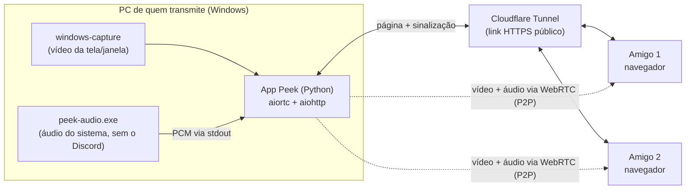

# 👀 Peek

Transmissão de tela com áudio para assistir junto com os amigos, feita para usar **ao lado do Discord**: vocês continuam conversando na call do Discord, e o Peek cuida só da imagem e do som da tela.

Quem transmite roda o app do Peek no Windows. Quem assiste só precisa abrir um link no navegador.

> **Status:** em desenvolvimento. Este README descreve a arquitetura e o funcionamento planejados; algumas seções podem mudar conforme o projeto evolui.

---

## Por que o Peek?

- **Sem eco da call.** Por padrão, o Peek captura todo o áudio do computador **exceto o do Discord**. Seus amigos ouvem o jogo, o vídeo ou a música, mas não ouvem a própria voz de volta.
- **Tela cheia ou uma janela específica.** Você escolhe o que mostrar.
- **Nada para instalar do lado de quem assiste.** É só abrir o link no navegador.
- **Custo zero.** O vídeo vai direto do seu PC para os seus amigos (P2P), sem servidor de mídia pago.

---

## Como funciona



| Componente | Tecnologia | Função |
|---|---|---|
| Captura de vídeo | [`windows-capture`](https://pypi.org/project/windows-capture/) (Windows Graphics Capture) | Captura a tela inteira ou uma janela específica |
| Captura de áudio | `peek-audio.exe` (C++, WASAPI Application Loopback) | Captura o áudio do sistema excluindo a árvore de processos do Discord |
| WebRTC | [`aiortc`](https://github.com/aiortc/aiortc) + [`PyAV`](https://github.com/PyAV-Org/PyAV) | Codifica e envia vídeo e áudio para cada espectador |
| Servidor | [`aiohttp`](https://docs.aiohttp.org/) | Serve a página do espectador e faz a sinalização via WebSocket |
| Acesso externo | [Cloudflare Tunnel](https://developers.cloudflare.com/cloudflare-one/connections/connect-networks/) (`cloudflared`) | Gera um link HTTPS público sem abrir portas no roteador |
| Espectador | HTML + JavaScript (WebRTC nativo do navegador) | Recebe e reproduz a transmissão |

O tunnel carrega apenas a página e a sinalização. O vídeo e o áudio trafegam diretamente entre o seu PC e o de cada amigo, usando o STUN público do Google para atravessar o NAT.

---

## Requisitos

**Para transmitir**

- Windows 11. A exclusão do áudio do Discord usa a API *Application Loopback*, documentada pela Microsoft a partir do Windows 10 build 20348.
- Python 3.11 ou superior
- [`cloudflared`](https://developers.cloudflare.com/cloudflare-one/connections/connect-networks/downloads/) instalado e no `PATH`
- Para compilar o `peek-audio.exe`: Visual Studio 2022 (ou Build Tools) com a carga de trabalho *Desenvolvimento para desktop com C++*
- Upload de internet suficiente: conte com cerca de **3–5 Mbps por espectador** em 720p/1080p a 30 fps

**Para assistir**

- Um navegador moderno (Chrome, Edge ou Firefox)

---

## Instalação

```bash
git clone https://github.com/<seu-usuario>/peek.git
cd peek

python -m venv .venv
.venv\Scripts\activate

pip install -r requirements.txt
```

### Compilando o helper de áudio

```bash
cd audio-helper
cmake -B build -G "Visual Studio 17 2022"
cmake --build build --config Release
copy build\Release\peek-audio.exe ..\host\bin\
```

---

## Uso

**1. Inicie o Peek**

```bash
# Tela inteira (monitor principal)
python -m host

# Uma janela específica (pelo título)
python -m host --window "Nome da janela"
```

**2. Exponha o Peek para os seus amigos** (em outro terminal)

```bash
cloudflared tunnel --url http://localhost:8080
```

O `cloudflared` vai exibir um endereço parecido com `https://algumas-palavras.trycloudflare.com`.

**3. Compartilhe o link**

Envie aos seus amigos o link mostrado pelo Peek no terminal. Ele inclui o token da sala, por exemplo:

```
https://algumas-palavras.trycloudflare.com/?room=8f3k2p
```

**4. Entrem na call do Discord e assistam.**

### Opções

| Opção | Padrão | Descrição |
|---|---|---|
| `--window "<título>"` | — | Transmite apenas a janela com esse título |
| `--monitor <n>` | `1` | Monitor a transmitir, quando não houver `--window` |
| `--resolution <LxA>` | `1280x720` | Resolução de saída |
| `--fps <n>` | `30` | Quadros por segundo |
| `--bitrate <kbps>` | `3000` | Bitrate máximo de vídeo por espectador |
| `--port <n>` | `8080` | Porta do servidor local |
| `--include-discord` | desligado | Inclui o áudio do Discord na transmissão |
| `--no-audio` | desligado | Transmite só o vídeo |

---

## Estrutura do projeto

```
peek/
├── host/                  # App de quem transmite (Python)
│   ├── __main__.py        # Ponto de entrada e argumentos de linha de comando
│   ├── server.py          # aiohttp: página do espectador + sinalização WebSocket
│   ├── capture/
│   │   ├── video.py       # Captura com windows-capture
│   │   └── audio.py       # Inicia o peek-audio.exe e lê o PCM
│   ├── rtc/
│   │   └── tracks.py      # VideoStreamTrack e AudioStreamTrack do aiortc
│   └── bin/
│       └── peek-audio.exe # Gerado pela compilação do audio-helper
├── audio-helper/          # Captura de áudio com exclusão do Discord (C++)
│   ├── CMakeLists.txt
│   └── src/main.cpp
├── web/                   # Página do espectador
│   ├── index.html
│   ├── viewer.js
│   └── style.css
├── requirements.txt
└── README.md
```

### Protocolo do helper de áudio

O `peek-audio.exe` escreve áudio bruto no `stdout` para o app Python ler:

- Formato: PCM *float32*, little-endian, intercalado
- Taxa de amostragem: 48 000 Hz
- Canais: 2 (estéreo)

Para descobrir o processo a excluir, o helper localiza o `Discord.exe` raiz (o processo cujo pai não é outro `Discord.exe`) e usa o modo `PROCESS_LOOPBACK_MODE_EXCLUDE_TARGET_PROCESS_TREE`, que remove o Discord e todos os seus subprocessos da captura.

---

## Limitações conhecidas

- **Uso de CPU.** O `aiortc` codifica o vídeo por software, e cada espectador recebe uma codificação própria. Com vários espectadores ou em resoluções altas, isso pode competir com o jogo pelo processador. Comece em 720p/30 fps e ajuste a partir daí.
- **Número de espectadores.** Por ser P2P, o upload necessário cresce a cada pessoa assistindo. O Peek foi pensado para grupos pequenos (até ~4 espectadores).
- **Somente Windows para transmitir.** A captura de vídeo e a exclusão de áudio dependem de APIs do Windows.
- **Redes restritivas.** Em algumas redes (corporativas, de faculdade ou 4G com NAT restritivo), a conexão direta pode falhar. Nesses casos é preciso configurar um servidor TURN.
- **Aviso do SmartScreen.** Executáveis sem assinatura de código podem disparar um alerta do Windows na primeira execução.

---

## Segurança e privacidade

- Qualquer pessoa com o link completo (incluindo o token `room`) pode assistir. Compartilhe o link apenas com quem você quer.
- Um novo token é gerado a cada vez que o Peek é iniciado. Encerrar o app invalida o link.
- Os links `trycloudflare.com` são temporários e não têm garantia de disponibilidade. Para uso contínuo, considere um tunnel nomeado na sua conta Cloudflare.
- O vídeo e o áudio são criptografados de ponta a ponta pelo próprio WebRTC (DTLS-SRTP).
- Lembre-se de que tudo o que estiver na tela ou na janela transmitida, incluindo notificações, fica visível para os espectadores.

---

## Roadmap

- [ ] Captura de vídeo + `aiortc` + página do espectador funcionando localmente
- [ ] Acesso externo via Cloudflare Tunnel
- [ ] `peek-audio.exe` com exclusão do Discord
- [ ] Integração do áudio com o app Python
- [ ] Suporte opcional a servidor TURN
- [ ] Interface gráfica para escolher tela ou janela (PySide6 ou Tkinter)
- [ ] Iniciar o `cloudflared` automaticamente pelo app
- [ ] Empacotamento com PyInstaller
- [ ] Estudo de encoder por hardware (GStreamer `webrtcbin`) para reduzir o uso de CPU

---

## Aviso

O Peek é um projeto independente e **não tem nenhuma afiliação com o Discord**. Ele não interage com o Discord além de identificar o processo para excluir o áudio dele da captura.

---

## Licença

Defina a licença do projeto (por exemplo, [MIT](https://choosealicense.com/licenses/mit/)) e adicione o arquivo `LICENSE` na raiz do repositório.