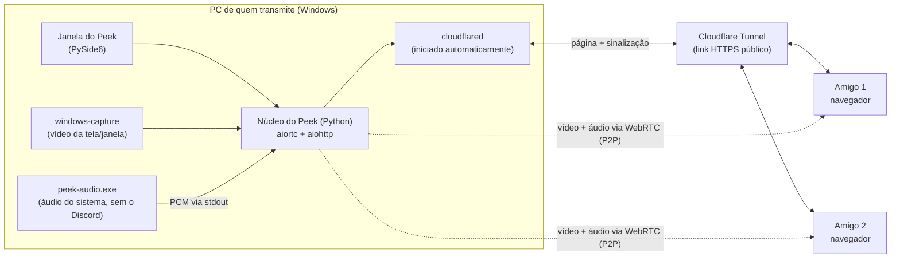

# 👀 Peek

Transmissão de tela com áudio para assistir junto com os amigos, feita para usar **ao lado do Discord**: vocês continuam conversando na call do Discord, e o Peek cuida só da imagem e do som da tela.

Quem transmite abre o Peek no Windows, escolhe o que quer mostrar e clica em um botão. Quem assiste só precisa abrir um link no navegador.

> **Status:** em desenvolvimento. Este README descreve o funcionamento planejado; algumas seções podem mudar conforme o projeto evolui.

---

## Princípio do projeto: transmitir tem que ser simples

O Peek é pensado para que **qualquer pessoa consiga transmitir, mesmo sem saber nada de programação**. Toda decisão de design deve respeitar estas regras:

1. **Baixar e abrir, nada mais.** Quem transmite baixa um único arquivo `Peek.exe` e dá dois cliques. Não é preciso instalar Python, abrir terminal, digitar comandos, configurar roteador ou criar conta em lugar nenhum.
2. **No máximo três passos para começar:** escolher o que mostrar, (opcionalmente) escolher a qualidade e clicar em **Começar a transmitir**.
3. **Tudo automático por baixo dos panos.** Exclusão do áudio do Discord, criação do link público, geração do código da sala e ajustes de rede acontecem sem a pessoa precisar saber que existem.
4. **Padrões que funcionam.** As configurações iniciais devem servir para a maioria dos casos. Ninguém deveria *precisar* mexer em nada.
5. **Linguagem do dia a dia.** A interface não usa termos técnicos como "bitrate", "WebRTC" ou "tunnel". Em vez de "1080p · 5000 kbps", ela diz "Nítida".
6. **Erros que explicam o que fazer.** Em vez de um código de erro, uma frase clara: *"Não foi possível criar o link. Verifique sua conexão com a internet e tente novamente."*
7. **Nenhuma janela de terminal** aparece para quem transmite.

Se uma funcionalidade nova exigir que quem transmite entenda algo técnico, ela deve ser repensada.

---

## Por que o Peek?

- **Sem eco da call.** O Peek captura todo o áudio do computador **exceto o do Discord**. Seus amigos ouvem o jogo, o vídeo ou a música, mas não ouvem a própria voz de volta.
- **Tela cheia ou uma janela específica.** Você escolhe o que mostrar.
- **Qualidade e FPS sob seu controle.** Escolha entre opções prontas, antes ou durante a transmissão, sem derrubar ninguém.
- **Nada para instalar do lado de quem assiste.** É só abrir o link no navegador.
- **Custo zero.** O vídeo vai direto do seu PC para os seus amigos, sem servidor pago.

---

## Para quem vai transmitir

Você só precisa de um computador com **Windows 11**.

### Como transmitir

1. **Baixe o Peek** na página de [Releases](https://github.com/<seu-usuario>/peek/releases) (arquivo `Peek.exe`).
2. **Abra o Peek** com dois cliques.
3. **Escolha o que mostrar:** clique na tela ou na janela que você quer transmitir.
4. **Clique em "Começar a transmitir".**
5. **Clique em "Copiar link"** e mande o link para seus amigos no chat do Discord.

Pronto! Para encerrar, clique em **Parar** ou feche o Peek.

Durante a transmissão, a janela do Peek mostra quantas pessoas estão assistindo. Você pode trocar a qualidade a qualquer momento pela própria janela.

### Na primeira vez

O Windows pode mostrar o aviso **"O Windows protegeu o computador"**. Isso acontece com programas novos que ainda não são conhecidos pela Microsoft. Clique em **Mais informações** e depois em **Executar assim mesmo**.

### Se algo der errado

| O que aconteceu | O que fazer |
|---|---|
| Meus amigos não ouvem o som | Confira se a opção **Incluir som** está marcada na janela do Peek. |
| Meus amigos se ouvem com atraso | Abra o Discord antes de começar a transmitir e reinicie a transmissão. |
| A imagem está travando | Escolha uma qualidade mais leve, como **Equilibrada** ou **Econômica**. |
| Um amigo não consegue entrar | Peça para ele tentar em outro navegador (Chrome ou Edge) ou em outra rede. |
| O antivírus bloqueou o Peek | Alguns antivírus desconfiam de programas novos. Adicione o Peek como exceção, se confiar na origem do arquivo. |

---

## Para quem vai assistir

Abra o link que recebeu em um navegador (Chrome, Edge ou Firefox) e pronto. Se o vídeo começar sem som, clique uma vez na tela: alguns navegadores só liberam o áudio depois de um clique.

---

## Qualidade e FPS

Quem transmite escolhe a qualidade na janela do Peek. Os espectadores veem um indicador discreto com a configuração atual.

| Opção na janela | Resolução | FPS | Limite de envio por espectador | Indicada para |
|---|---|---|---|---|
| Econômica | 480p | 30 | 1,5 Mbps | Internet mais fraca ou muitos espectadores |
| **Equilibrada** (padrão) | 720p | 30 | 3 Mbps | Uso geral |
| Nítida | 1080p | 30 | 5 Mbps | Filmes, séries e conteúdo com texto |
| Fluida | 720p | 60 | 4,5 Mbps | Jogos com bastante movimento |
| Máxima | 1080p | 60 | 8 Mbps | PCs potentes com internet rápida |

Uma opção **Personalizada** fica escondida em "Mais opções" para quem quiser ajustar resolução, FPS e limite de envio individualmente.

**Como deve funcionar:**

- A troca de qualidade vale na hora, sem reconectar ninguém. A imagem pode piscar por um instante.
- A resolução nunca é aumentada além da original: uma janela pequena é enviada no tamanho real.
- O limite de envio é um **teto**. O Peek reduz automaticamente a qualidade para quem tiver uma conexão mais fraca.
- Se o PC não der conta da opção escolhida (por exemplo, o FPS real cair muito abaixo do pedido), o Peek deve avisar em linguagem simples e sugerir uma opção mais leve.

---

## Como funciona



| Componente | Tecnologia | Função |
|---|---|---|
| Interface | [`PySide6`](https://doc.qt.io/qtforpython-6/) | Janela simples para escolher tela, qualidade e copiar o link |
| Captura de vídeo | [`windows-capture`](https://pypi.org/project/windows-capture/) (Windows Graphics Capture) | Captura a tela inteira ou uma janela específica |
| Captura de áudio | `peek-audio.exe` (C++, WASAPI Application Loopback) | Captura o áudio do sistema excluindo a árvore de processos do Discord |
| WebRTC | [`aiortc`](https://github.com/aiortc/aiortc) + [`PyAV`](https://github.com/PyAV-Org/PyAV) | Codifica e envia vídeo e áudio para cada espectador |
| Servidor | [`aiohttp`](https://docs.aiohttp.org/) | Serve a página do espectador e faz a sinalização via WebSocket |
| Link público | [`cloudflared`](https://developers.cloudflare.com/cloudflare-one/connections/connect-networks/) (incluído no `Peek.exe`) | Cria um link HTTPS sem abrir portas no roteador |
| Espectador | HTML + JavaScript (WebRTC nativo do navegador) | Recebe e reproduz a transmissão |

O link público carrega apenas a página e a sinalização. O vídeo e o áudio trafegam diretamente entre o PC de quem transmite e o de cada amigo, usando o STUN público do Google para atravessar o NAT.

---

## Para desenvolvedores

Esta seção é para quem vai trabalhar no código. **Quem só quer transmitir não precisa de nada daqui.**

### Requisitos

- Windows 11 (a API *Application Loopback* é documentada pela Microsoft a partir do Windows 10 build 20348)
- Python 3.11 ou superior
- [`cloudflared`](https://developers.cloudflare.com/cloudflare-one/connections/connect-networks/downloads/) no `PATH` (para desenvolvimento; no `Peek.exe` ele vai embutido)
- Visual Studio 2022 (ou Build Tools) com *Desenvolvimento para desktop com C++*, para compilar o `peek-audio.exe`

### Instalação

```bash
git clone https://github.com/<seu-usuario>/peek.git
cd peek

python -m venv .venv
.venv\Scripts\activate

pip install -r requirements-dev.txt   # inclui requirements.txt + ferramentas de desenvolvimento
```

### Verificações

```bash
ruff check . && ruff format --check .
pytest                   # inclui testes com captura real (marcador "capture")
pytest -m "not capture"  # sem sessão gráfica do Windows (ex.: CI)

# Salva um frame de cada monitor (ou --window "título", ou --all) em snapshots/
python -m tools.snapshot
```

Os logs ficam em `%LOCALAPPDATA%\Peek\logs\peek.log` (uma linha JSON por evento).

### Compilando o helper de áudio

```bash
cd audio-helper
cmake -B build -G "Visual Studio 17 2022"
cmake --build build --config Release
copy build\Release\peek-audio.exe ..\host\bin\
```

### Rodando em modo de desenvolvimento

```bash
# Abre a interface gráfica (mesma experiência do Peek.exe)
python -m host

# Modo sem interface, útil para testes e depuração
python -m host --headless --window "Nome da janela" --quality fluida
```

No modo `--headless`, o link da transmissão é exibido no terminal.

### Opções de linha de comando

Estas opções existem só para desenvolvimento e testes. Tudo o que elas fazem também precisa estar disponível pela interface gráfica.

| Opção | Padrão | Descrição |
|---|---|---|
| `--headless` | desligado | Roda sem interface gráfica |
| `--window "<título>"` | — | Transmite apenas a janela com esse título |
| `--monitor <n>` | `1` | Monitor a transmitir, quando não houver `--window` |
| `--quality <preset>` | `equilibrada` | `economica`, `equilibrada`, `nitida`, `fluida` ou `maxima` |
| `--resolution <altura>` | do preset | `480`, `720`, `1080` ou `original` |
| `--fps <n>` | do preset | `15`, `30` ou `60` |
| `--bitrate <kbps>` | do preset | Limite de envio de vídeo por espectador |
| `--port <n>` | `8080` | Porta local do servidor dos espectadores |
| `--no-tunnel` | desligado | Não inicia o `cloudflared` (para testes em rede local) |
| `--include-discord` | desligado | Inclui o áudio do Discord na transmissão |
| `--no-audio` | desligado | Transmite só o vídeo |
| `--list-sources` | — | Lista as telas e janelas disponíveis e sai |
| `--debug` | desligado | Logs detalhados |

### Gerando o `Peek.exe`

O executável final é gerado com [PyInstaller](https://pyinstaller.org/) em modo de janela (sem terminal) e arquivo único, embutindo o `peek-audio.exe`, o `cloudflared.exe` e a página do espectador:

```bash
pyinstaller peek.spec
```

O resultado fica em `dist\Peek.exe` e é o arquivo publicado nas Releases. O `cloudflared` é distribuído sob a licença Apache 2.0; mantenha o aviso de licença dele junto ao projeto.

### Protocolo do helper de áudio

O `peek-audio.exe` escreve áudio bruto no `stdout` para o núcleo Python ler:

- Formato: PCM *float32*, little-endian, intercalado
- Taxa de amostragem: 48 000 Hz
- Canais: 2 (estéreo)

O helper localiza o `Discord.exe` raiz (o processo cujo pai não é outro `Discord.exe`) e usa o modo `PROCESS_LOOPBACK_MODE_EXCLUDE_TARGET_PROCESS_TREE`, que remove o Discord e todos os seus subprocessos da captura. Se o Discord for aberto depois do início da transmissão, o Peek deve detectar isso e reiniciar a captura de áudio automaticamente, sem intervenção de quem transmite.

### Estrutura do projeto

```
peek/
├── host/                  # App de quem transmite (Python)
│   ├── __main__.py        # Ponto de entrada (interface ou --headless)
│   ├── gui/
│   │   ├── main_window.py # Janela principal: escolher tela, qualidade, copiar link
│   │   └── messages.py    # Textos e mensagens de erro em linguagem simples
│   ├── server.py          # aiohttp: página do espectador + sinalização WebSocket
│   ├── tunnel.py          # Inicia e monitora o cloudflared, obtém o link público
│   ├── capture/
│   │   ├── video.py       # Captura com windows-capture
│   │   └── audio.py       # Inicia o peek-audio.exe e lê o PCM
│   ├── rtc/
│   │   ├── tracks.py      # VideoStreamTrack e AudioStreamTrack do aiortc
│   │   └── quality.py     # Presets e aplicação de resolução, FPS e bitrate
│   └── bin/
│       ├── peek-audio.exe # Gerado pela compilação do audio-helper
│       └── cloudflared.exe
├── audio-helper/          # Captura de áudio com exclusão do Discord (C++)
│   ├── CMakeLists.txt
│   └── src/main.cpp
├── web/                   # Página do espectador
│   ├── index.html
│   ├── viewer.js
│   └── style.css
├── peek.spec              # Configuração do PyInstaller
├── requirements.txt
└── README.md
```

---

## Limitações conhecidas

- **Uso de CPU.** O `aiortc` codifica o vídeo por software, e cada espectador recebe uma codificação própria. Com vários espectadores ou nas opções de 60 fps, isso pode competir com o jogo pelo processador. Por isso o padrão é a opção **Equilibrada**.
- **Número de espectadores.** Por ser P2P, o upload necessário cresce a cada pessoa assistindo. O Peek foi pensado para grupos pequenos (até ~4 espectadores).
- **Somente Windows 11 para transmitir.** A captura de vídeo e a exclusão de áudio dependem de APIs do Windows. Em versões antigas, o Peek deve avisar claramente que não é compatível.
- **Redes restritivas.** Em algumas redes (corporativas, de faculdade ou 4G com NAT restritivo), a conexão direta pode falhar. Nesses casos é preciso um servidor TURN.
- **Avisos do Windows e de antivírus.** Executáveis sem assinatura de código, especialmente os gerados com PyInstaller, podem disparar o SmartScreen ou falsos positivos em antivírus. Assinar o executável resolve, mas tem custo.
- **Links temporários.** Os links `trycloudflare.com` mudam a cada transmissão e não têm garantia de disponibilidade.

---

## Segurança e privacidade

- Qualquer pessoa com o link pode assistir. Compartilhe-o apenas com quem você quer.
- Cada transmissão gera um link novo. Clicar em **Parar** ou fechar o Peek invalida o link.
- Os controles da transmissão (qualidade, parar, escolher tela) existem **somente na janela do Peek** no computador de quem transmite. Nada disso é acessível pelo link enviado aos amigos.
- O vídeo e o áudio são criptografados de ponta a ponta pelo próprio WebRTC (DTLS-SRTP).
- Tudo o que estiver na tela ou na janela transmitida, incluindo notificações, fica visível para os espectadores. Ao escolher **tela inteira**, a interface do Peek deve lembrar disso de forma breve.

---

## Roadmap

**Base técnica**

- [ ] Captura de vídeo + `aiortc` + página do espectador funcionando localmente
- [ ] Link público via `cloudflared`
- [ ] `peek-audio.exe` com exclusão do Discord
- [ ] Integração do áudio com o núcleo Python
- [ ] Opções de qualidade com troca em tempo real

**Experiência simples para quem transmite (obrigatório para a versão 1.0)**

- [ ] Janela principal com miniaturas das telas e janelas disponíveis
- [ ] Botões **Começar a transmitir**, **Copiar link** e **Parar**
- [ ] `cloudflared` e helper de áudio iniciados automaticamente, sem terminal
- [ ] Detecção automática do Discord, inclusive se ele for aberto depois
- [ ] Mensagens de erro em linguagem simples, com o que fazer
- [ ] Aviso amigável quando o Windows não for compatível
- [ ] Contador de pessoas assistindo
- [ ] `Peek.exe` único, publicado nas Releases
- [ ] Teste com alguém que não programa: transmitir do zero, sem ajuda, em menos de 2 minutos

**Depois da 1.0**

- [ ] Suporte opcional a servidor TURN
- [ ] Sugestão automática de qualidade conforme o PC e a internet
- [ ] Estudo de encoder por hardware (GStreamer `webrtcbin`) para reduzir o uso de CPU
- [ ] Assinatura de código do executável

---

## Aviso

O Peek é um projeto independente e **não tem nenhuma afiliação com o Discord**. Ele não interage com o Discord além de identificar o processo para excluir o áudio dele da captura.

---

## Licença

Defina a licença do projeto (por exemplo, [MIT](https://choosealicense.com/licenses/mit/)) e adicione o arquivo `LICENSE` na raiz do repositório.